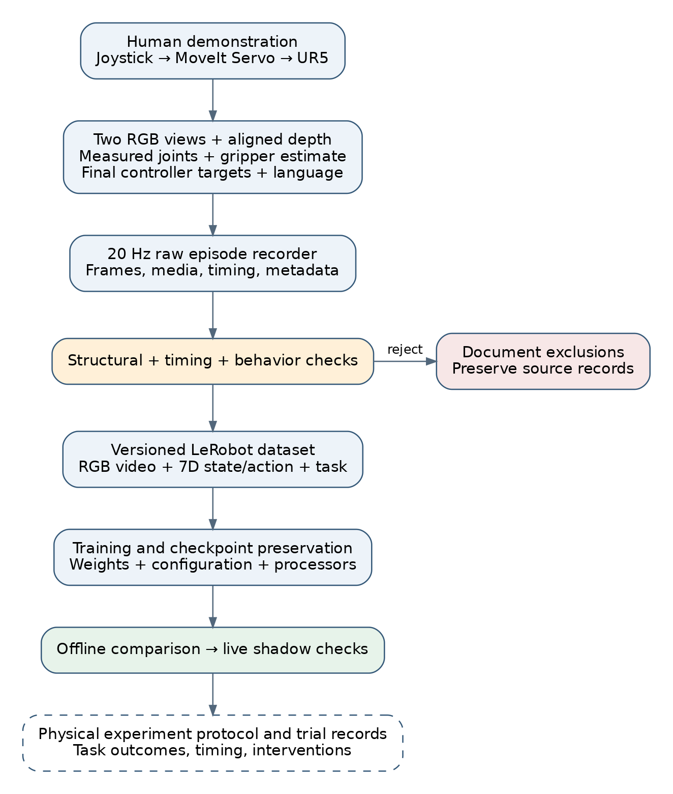
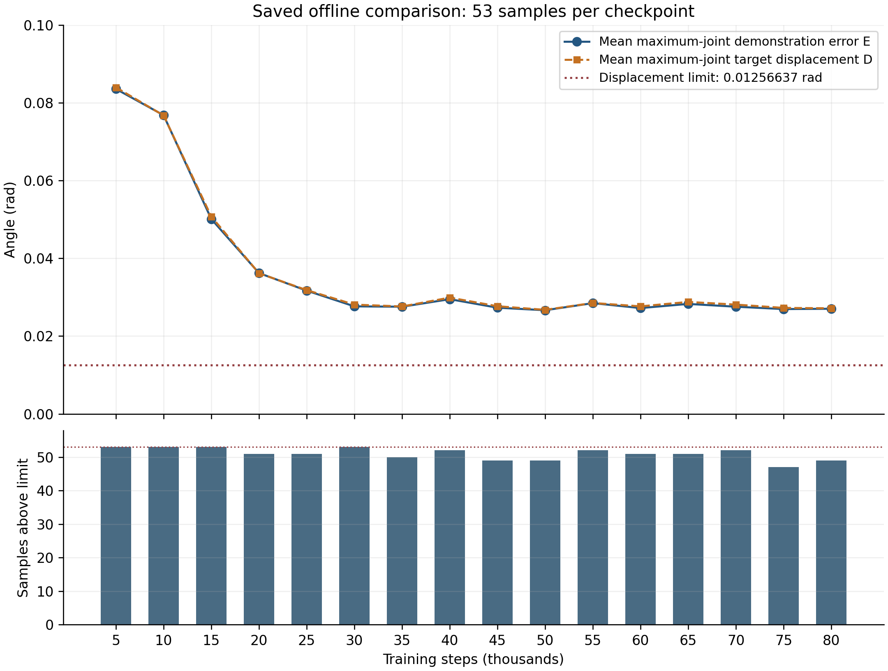
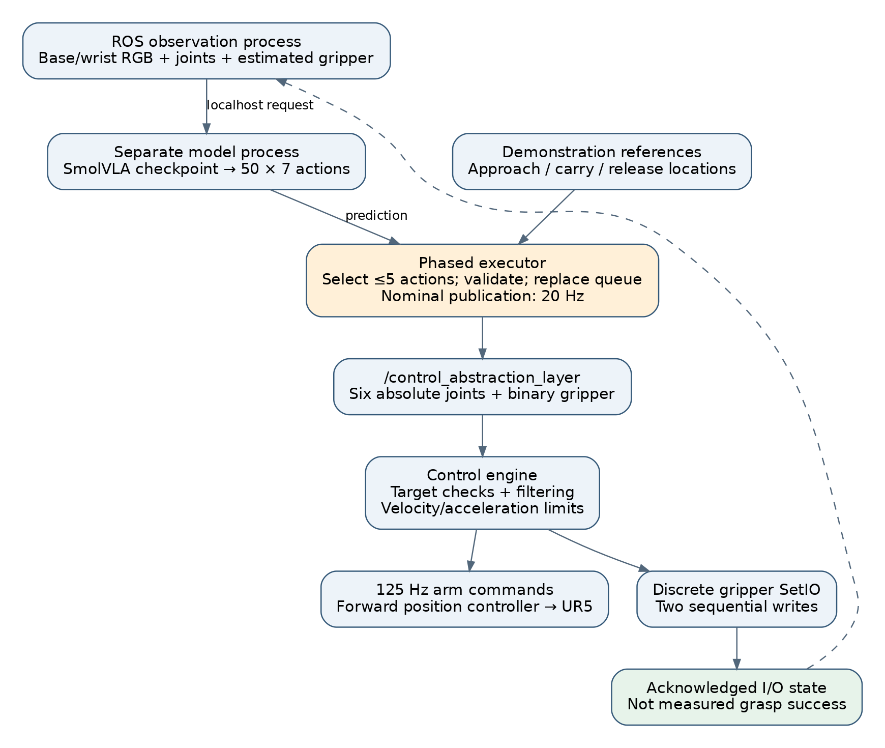
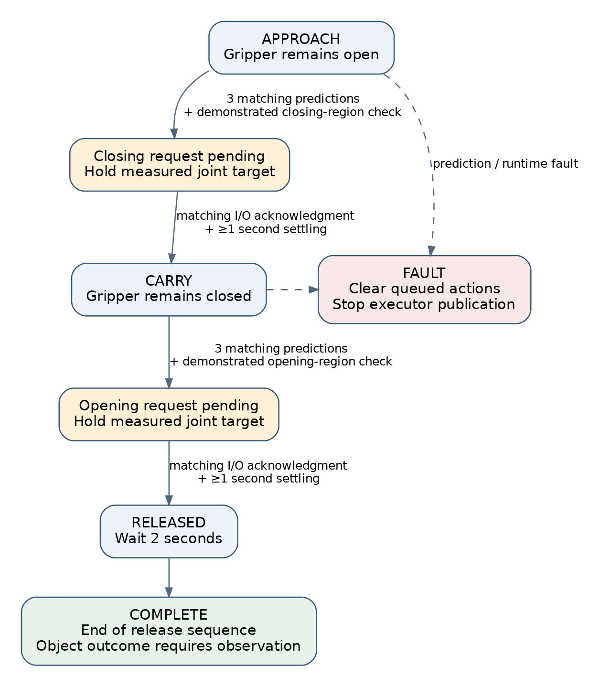

# Development and Validation of the UR5 Experimental Platform

**Drafting note.** This chapter reconstructs the experiment from the local project documentation, dataset metadata, saved prediction reports, and implemented control software inspected on 30 September 2026. It distinguishes recorded findings from implementation decisions and proposed evaluation. The available records support a detailed account of system development, but do not establish a final autonomous task-success rate. References [E1–E14] point to the accompanying evidence register. Replace the chapter number and add the thesis bibliography before submission.

**Chapter scope.** The present draft explains how the platform reached its current experimental milestone: demonstrations can be collected and validated, models can be trained and transferred, predictions can be evaluated, and alternative execution strategies can be investigated through implemented interfaces. The orange-cube task is the current development case study. Subsequent tasks and comparative studies can be added using the experiment record at the end of the chapter. The completed infrastructure provides a basis for producing results; each new experimental condition still requires its own validation and outcome records.

## 1. Experimental objective and scope

The experimental work investigated how a vision–language–action policy could be connected to a physical Universal Robots UR5 manipulation system. The principal task in the later experiments was expressed as: “Pick up the orange cube and place it in the bowl.” Completing this task required the robot to approach the cube, close the pneumatic gripper, transport the object, and release it at the destination. The earlier pipeline-development dataset used a tray instruction. These task labels belong to different experimental stages and must be kept distinct when discussing datasets and checkpoints. [E1, E2]

The work involved more than training a neural network. A complete experimental system had to maintain a consistent relationship between camera observations, robot state, demonstrated actions, model inputs, and commands delivered to the controller. Errors at any interface could produce plausible-looking training data or model outputs while preventing useful physical execution. The experimental approach therefore developed data collection, validation, model training, inference, and motion execution as separately inspectable components.

Three questions organized the work. First, how could human demonstrations be recorded without changing the meaning of the action that the robot actually received? Second, how could data and model artifacts be moved between the ROS workstation and the training environment without losing timing information, feature definitions, or preprocessing? Third, how could chunked model predictions be translated into incremental robot motion while preserving the order of grasping and releasing?

The records document solutions to these engineering problems and several quantitative model checks. They do not support a claim that the final controller achieved reliable pick-and-place performance across a specified test distribution. Accordingly, the discussion separates infrastructure validation, prediction evaluation, and physical task evaluation.

## 2. Physical platform and system architecture

The documented platform comprised a six-joint UR5 arm, a pneumatic gripper, a Logitech Extreme 3D Pro joystick, and two Intel RealSense cameras. A D435i provided the base-camera view and a D435 provided the wrist-camera view. The software stack used ROS 2 Humble, MoveIt 2, MoveIt Servo, and the Universal Robots driver. Both cameras were configured for USB 3 operation, with RGB and aligned depth streams at a nominal resolution of 640 × 480 pixels and a configured camera rate of 30 frames per second. Demonstration sampling was configured at 20 Hz. These are configuration values, rather than measurements of sustained frame delivery. [E1, E3]

The base and wrist views supplied complementary visual perspectives. The base image represented the workspace, whereas the wrist image represented the scene near the end effector. Both views were retained as separate named features throughout conversion and training. Depth was recorded for archival and potential later use, but the inspected SmolVLA training artifacts used RGB images, robot state, and language rather than depth inputs.

During demonstration collection, joystick inputs were translated into Cartesian velocity requests for MoveIt Servo. Servo produced the final joint-position commands consumed by the forward position controller. The recorder subscribed to these streams independently of motion generation; it did not start Servo, switch controllers, or command the arm. This separation allowed the acquisition system to reject invalid samples without changing the operator’s command-generation pipeline.



*Figure 1. The demonstrated controller target is recorded alongside camera and measured-state observations. Raw episodes remain the source data; validated derivatives support training and evaluation. A completed physical evaluation is a separate evidence stage.*

The project contained multiple deployment architectures at different stages. The earlier documented guarded executor used MoveIt Servo and a manually armed, bounded JointJog pulse. The later scripts in the `bypass` workspace used a seven-value abstraction topic and a separate smoothing engine that published to the forward position controller. The latter engine also requested that Servo stop. These architectures must not be described as one unchanged command path: checks documented for the earlier guarded executor were not automatically present in the later bypass implementation. [E9, E10]

## 3. Observation, state, and action definitions

At an observation time t, the learning input can be written as:

```text
oₜ = {Iᵇₜ, Iʷₜ, sₜ, ℓ}
sₜ = [q₁,ₜ, q₂,ₜ, q₃,ₜ, q₄,ₜ, q₅,ₜ, q₆,ₜ, ĝₜ]
```

Here, Iᵇ and Iʷ are the base and wrist RGB images, q is the measured joint-position vector, ĝ is the estimated gripper state, and ℓ is the language instruction. Joint angles are expressed in radians. The gripper convention is 0 for closed and 1 for open.

The absolute action was defined as:

```text
aₜ = [q*₁,ₜ, q*₂,ₜ, q*₃,ₜ, q*₄,ₜ, q*₅,ₜ, q*₆,ₜ, g*ₜ]
```

The first six values are commanded absolute joint positions and the seventh is an absolute binary gripper request. Measured joint positions and commanded joint positions are different quantities: the former describe the observed robot configuration, while the latter describe the target delivered to its controller.

An important design decision was to record the final joint targets instead of raw joystick axes. The joystick describes the operator’s request before coordinate mapping, inverse kinematics, motion limiting, and Servo processing. Recording the downstream controller target preserved the action interface that the learned policy would later have to reproduce. This is an interface-consistency argument; it does not imply that the physical robot exactly followed every recorded target. [E1]

All components used the canonical order `shoulder_pan_joint`, `shoulder_lift_joint`, `elbow_joint`, `wrist_1_joint`, `wrist_2_joint`, and `wrist_3_joint`. Incoming joint-state messages were reordered using joint names. Missing or duplicate names and non-finite values were rejected. This prevented a numerically valid six-element vector from being interpreted with the wrong joint correspondence. [E3]

The gripper had no position sensor in the documented configuration. Its state represented the last command acknowledged by the SetIO service. Such an acknowledgment establishes that an I/O request succeeded; it does not establish finger position, contact, object retention, or successful placement. This distinction applies both to the dataset state and to the later execution feedback.

## 4. Demonstration acquisition and episode management

The acquisition system periodically sampled the latest available messages and checked their receive ages. It retained source timestamps and receive-age diagnostics in each raw frame. Thus, the implementation provided freshness-bounded multimodal sampling; the inspected code does not establish hardware-synchronized camera exposure or exact timestamp matching across sensors. This qualification matters because an image and a joint state can both be fresh without corresponding to precisely the same physical instant. [E3]

The configured maximum receive ages for RGB, depth, joints, and arm commands were 0.10 s. Gripper freshness was handled separately, with a 0.20 s limit documented in the initial validation results. Missing inputs, stale inputs, invalid numerical values, or nonzero Servo status prevented acceptance of a frame under the configured checks. The recorder also used a bounded background writing queue, configured to 60 entries, and a minimum-free-disk threshold of 20 GB. These mechanisms addressed the separation between real-time acquisition and slower image and metadata storage.

RGB images were written as JPEG files, with JPEG quality configured to 90. Aligned depth was stored losslessly as 16-bit PNG. The default depth scale was 0.001 m per stored unit and was retained in episode metadata. A depth value was therefore interpretable only together with its scale and validity convention; it was not treated as an ordinary RGB intensity.

Each episode included a `frames.jsonl` manifest and metadata. Frames associated image paths with state, action, task, elapsed episode time, source timestamps, freshness information, and Servo status. Episode controls were available through ROS services and rising-edge joystick button events. Physical button 9 started recording, button 10 discarded the current attempt, and button 11 saved the episode as successful, according to the configured mapping. Edge-triggered handling prevented holding a button from repeatedly invoking an operation.

An active or unlabelled recording used a hidden directory ending in `.incomplete`. Finalization validated metadata and atomically renamed the directory. Consequently, an interrupted or unfinished recording was distinguishable from a finalized episode. Raw finalized episodes were retained as source records, while selections and conversions were expressed through separate artifacts and manifests.

The success label at collection time represented the operator’s assessment of a demonstration. It should not be confused with an autonomously verified outcome or with the success rate of a learned policy.

## 5. Dataset validation, cleaning, and revision

### 5.1 From structural validity to behavioral quality

The initial validation report documented 10 episodes containing 20,583 frames. Every referenced RGB and depth image was decoded, and all ten episodes passed the checks in use at that stage. Checks included finite state and action values, canonical joint order, valid media, increasing timestamps, gripper transitions, freshness, and agreement between manifests and metadata. [E4]

Later inspection showed that this definition of validity was insufficient to establish a clean imitation-learning example. An episode could contain valid files and increasing timestamps while also including a long acquisition gap or more than one task attempt. Several initially accepted episodes were excluded under the later criteria. This progression is best understood as an expansion of the validation specification: structural integrity and demonstration quality answer different questions.

### 5.2 Action discontinuity

The documented 29-episode collection contained an episode with a large target discontinuity between frames 16 and 17. The elapsed times were approximately 0.82875 and 0.87838 s, while the elbow target changed by 1.471315 rad. Other joints also changed substantially. The handoff recorded exclusion of this episode, producing 28 accepted episodes and 47,204 frames. The dataset name `ur5_cube_30ep` was retained, although its metadata correctly reported 28 episodes. [E2]

The response was to exclude the episode explicitly rather than silently interpolate or rewrite its actions. This preserved the original evidence and avoided introducing a synthetic trajectory without an established physical interpretation. The artifact name was not used as the authority for episode count.

### 5.3 Acquisition gaps and repeated attempts

Subsequent cleaning identified four episodes with multi-second timestamp gaps and five episodes containing multiple attempts, with one episode belonging to both groups. Together with the discontinuous episode, there were nine unique exclusions. The largest listed acquisition gap was 18.999 s. The revised selection contained 20 episodes and 32,022 frames. The exclusion manifest recorded each episode and its reason. [E2, E5]

The timing problem arose because a fixed-rate converted dataset could place two retained samples beside each other even when the original recording paused for several seconds. If interpreted as successive 20 Hz samples, those frames would imply a transition over approximately 0.05 s. A raw-frame interval limit of 0.20 s was added to reject such recordings before conversion. Original elapsed times were also retained as a source-time feature.

Repeated attempts created another ambiguity. For the intended single pick-and-place sequence, an open–close–open pattern represented one grasp and release cycle. Episodes with four transitions could include retries or multiple attempts, causing the training sequence to combine task progression with recovery behavior. The clean selection removed the listed examples. This criterion was specific to the chosen task protocol; it is not a general claim that recovery demonstrations are undesirable.

### 5.4 Dataset identity and later collections

The inspected artifacts show several dataset stages:

| Dataset or documented selection | Episodes | Frames | Interpretation |
|---|---:|---:|---|
| `ur5_orange_cube_v1` | 10 | 20,583 | Initial pipeline dataset; tray instruction |
| `ur5_cube_30ep` | 28 | 47,204 | Accepted subset after one discontinuity exclusion; bowl instruction |
| Earlier clean selection in handoff | 20 | 32,022 | Selection defined by the nine-exclusion manifest |
| Current `ur5_cube_clean_20ep` | 20 | 53,084 | Later artifact; source episode names are dated 28 August |
| `ur5_cube_clean_20ep_delta` | 20 | 53,084 | Derived representation of the current 20-episode dataset |
| `ur5_cube_clean_53ep` | 53 | 67,621 | Dataset associated with saved checkpoint comparisons |
| `ur5_cube_clean_73ep_v2` | 73 | 196,707 | Dataset referenced by the later selected SmolVLA artifact |

The two 20-episode entries are distinct records. Their frame counts must not be combined or treated as conflicting measurements of one immutable artifact. The current 20-episode conversion manifest identifies later source episodes, whereas the earlier selection is documented in the August handoff. Similarly, the 73-episode frame count cannot be reconstructed simply by adding the displayed 53- and 20-episode counts. Dataset lineage should be stated from conversion manifests, rather than inferred from names. [E5, E6]

The converted metadata inspected for these datasets listed all episodes in the training split. No independent held-out test split was established by that metadata. Offline checks on these artifacts therefore characterize predictions on the sampled data, not generalization to unseen scenes.

## 6. Conversion, storage, and artifact integrity

Validated raw recordings were converted to LeRobot v3 datasets. The inspected RGB features were `observation.images.base` and `observation.images.wrist`, stored as AV1 video at 20 Hz. State and action were seven-dimensional float vectors. Conversion metadata retained the joint order, units, gripper convention, source episode names, and action semantics. Depth remained available in the raw records but was excluded from the default RGB training derivative. [E6]

The conversion workflow checked both sides of the transformation. Raw validation established that the input files and trajectories met the selection criteria. Converted-dataset validation checked episode and frame counts, feature shapes, task text, gripper values, and video decoding through the dataset-loading interface. This distinction addressed the possibility that valid raw files could still produce an incomplete or incorrectly specified converted dataset.

Large transfers and long conversions introduced practical reliability problems. The workflow used local Colab storage for conversion and training, then copied completed artifacts to Google Drive. Later conversion notebooks used temporary `.copying` destinations, verified files with SHA-256, and renamed the destination only after verification. The initial training workflow used file-size manifests when synchronizing complete numbered checkpoints. These mechanisms should be described separately because not every historical copy operation used the same verification method. [E2, E7]

Progress messages were added for raw preflight checks, frame staging, video encoding, episode completion, and finalization. This made a slow conversion distinguishable from a failed or stalled operation. Interrupted conversion outputs were kept separate from authoritative datasets; the inspected tree also contained quarantined partial conversions.

The checkpoint was treated as a complete artifact. Reloading required model weights together with model configuration, preprocessing and postprocessing definitions, normalization tensors, and applicable tokenizer or processor assets. Resumable training additionally required training state. Saving only a weights file would not preserve the full deployment interface.

## 7. Training configuration and compatibility problems

### 7.1 Incremental training development

The first documented SmolVLA experiment used the 10-episode dataset and a 5,000-step training configuration. Its role was to exercise loading, batching, training, checkpoint export, and offline inference. The training runbook specified a batch size of one, mixed precision, and checkpointing every 500 steps. A later 28-episode workflow used 40,000 steps and checkpoint intervals of 5,000 steps. The handoff reported completion of that 40,000-step run, while also recording that older checkpoint-retention logic had removed several intermediate checkpoints. [E2, E7]

The retention policy was subsequently changed to preserve every completed Drive checkpoint. This allowed evaluation across training stages instead of assuming that the final checkpoint was best. The saved 53-episode comparisons provide a concrete example of why retaining intermediate artifacts was useful.

The later selected local artifact references `ur5_cube_clean_73ep_v2`. Its saved training configuration specifies the following settings. These values describe the saved run configuration; they do not independently measure training duration or verify the GPU model used at runtime. [E8]

| Setting | Saved value |
|---|---|
| Policy and pretrained path | SmolVLA; `lerobot/smolvla_base` |
| Dataset | 73 episodes; 196,707 frames |
| Inputs | Two RGB views, seven-dimensional state, task instruction |
| Output | Fifty seven-dimensional actions per prediction |
| Batch size and configured steps | 96; 16,500 |
| Optimizer | AdamW; learning rate 0.0001 |
| Learning-rate schedule | Cosine decay; 825 warmup steps; final rate 0.0000025 |
| Gradient clipping norm | 10 |
| Seed | 42 |
| Mixed precision | Enabled |
| Vision encoder | Configured frozen |
| Training flags | Expert-only training and state-projection training enabled |
| State/action normalization | Mean and standard deviation |
| Dataset image augmentation | Disabled |
| Configured checkpoint interval | 2,500 steps |
| Automated environment evaluation | Disabled (`eval_freq = 0`) |

Although the run name includes “A100,” hardware identity should be supported by a runtime log before being reported as a measured experimental condition. A π0 notebook generator also exists, but notebook availability alone does not demonstrate a completed π0 training run or a model comparison.

### 7.2 Camera-feature and action-horizon mismatches

The generic pretrained model configuration did not initially match the dataset’s named camera features. Loading that configuration too early introduced generic feature names before the training code had derived the physical robot’s base and wrist inputs. The documented solution constructed a fresh training configuration referencing the pretrained weights and derived features from the dataset before loading those weights. [E7]

A related compatibility check had to resolve action timestamps so that the training batch contained the expected 50-action horizon. A single-action target could not substitute for the required action chunk. The lesson was to check the complete batch interface—camera names, tensor dimensions, state dimensions, and horizon—before committing to a long training run.

### 7.3 Python, library, and video-decoding compatibility

ROS 2 Humble nodes used the system Python 3.10 environment, while the model environment used a different Python runtime and LeRobot installation. The handoff described a local configuration mismatch in which one LeRobot checkout rejected a checkpoint’s `use_peft` field. The checkpoint loaded successfully in the documented `pi0` Conda environment. Rather than placing ROS and model dependencies in a single interpreter, the project separated ROS subscriptions and command logic from model inference. [E2]

Colab also encountered a partially initialized Torchvision error. The recorded remedy installed the matching Torch 2.7.1 and Torchvision 0.22.1 packages before importing them and restarted a runtime that had already imported the earlier libraries. A separate video-decoding issue involved TorchCodec failing to load available FFmpeg libraries; the documented workflow selected PyAV. These were environment and compatibility corrections, not changes to the demonstrated behavior or learning objective. [E2, E7]

## 8. Offline evaluation and observed results

### 8.1 Initial checkpoint inspection

The saved 100-sample report for the initial checkpoint contained finite seven-dimensional first-action predictions. Recalculation from its comparison CSV gives the per-joint mean absolute errors below. The sampled gripper classifications were all correct at the threshold of 0.5. [E11]

| Joint | Mean absolute error, rad |
|---|---:|
| Shoulder pan | 0.02284 |
| Shoulder lift | 0.02198 |
| Elbow | 0.02586 |
| Wrist 1 | 0.02693 |
| Wrist 2 | 0.02884 |
| Wrist 3 | 0.01447 |

The saved mean inference latency was 0.31279 s, with a median of 0.30443 s and a maximum of 0.56092 s. These values apply to that recorded offline run. They are not end-to-end control-loop measurements and must not be transferred to the later 73-episode checkpoint without a new measurement.

The result established structural compatibility and sampled prediction agreement. It did not demonstrate successful grasping. In particular, perfect binary gripper classification on sampled frames does not establish correct transition timing, grasp contact, or object retention during a physical rollout. Likewise, differences between sparsely sampled predictions should not be interpreted as consecutive 20 Hz execution jumps unless the sampled frames are actually adjacent.

### 8.2 Checkpoint comparison on the 53-episode dataset

The evaluation directory contains 16 reports for checkpoints from 5,000 through 80,000 steps, each containing 53 sampled observations. The reports distinguish prediction error relative to the demonstrated action from prediction displacement relative to the measured state:

```text
Eₙ = maxⱼ |q̂ₙ,ⱼ − q*ₙ,ⱼ|      j = 1,…,6
Dₙ = maxⱼ |q̂ₙ,ⱼ − qₙ,ⱼ|       j = 1,…,6
```

E measures imitation error for a sample, using the largest joint error. D measures the largest requested movement from the observed configuration. The reported mean of E is therefore not the same statistic as averaging absolute error across all joints. The evaluation gate compared D with 0.01256637 rad. [E12]

| Training steps | Mean E, rad | Mean D, rad | Maximum D, rad | Samples above D limit |
|---:|---:|---:|---:|---:|
| 5,000 | 0.08357 | 0.08398 | 0.17870 | 53/53 |
| 20,000 | 0.03621 | 0.03617 | 0.08853 | 51/53 |
| 35,000 | 0.02755 | 0.02762 | 0.07142 | 50/53 |
| 50,000 | 0.02665 | 0.02675 | 0.08076 | 49/53 |
| 75,000 | 0.02695 | 0.02725 | 0.08594 | 47/53 |
| 80,000 | 0.02703 | 0.02716 | 0.09207 | 49/53 |



*Figure 2. All 16 saved comparisons are plotted. The top panel distinguishes demonstration error from requested displacement. The dashed line is the displacement gate, not a task-success threshold. The lower panel reports samples exceeding that gate. These are sampled offline results, not physical rollout success rates.*

The mean maximum-joint demonstration error fell from approximately 0.08357 rad at 5,000 steps to 0.02665 rad at 50,000 steps, a reduction of approximately 68.1%. The 50,000-step checkpoint had the lowest mean demonstration error among the saved reports. The 75,000-step checkpoint had the fewest displacement-limit violations, but still exceeded the limit on 47 of 53 samples. Every saved checkpoint had a false pass flag.

These results show why the experiment required more than a decreasing training loss or improving average error. A checkpoint could better reproduce demonstrated targets while still requesting movements outside the selected execution envelope. The data also do not establish monotonic improvement with training: later checkpoints did not uniformly improve all reported metrics. No confidence intervals, repeated inference trials, or independent test-set results were established by these saved reports.

### 8.3 Live shadow observations

The handoff recorded successful live shadow inference after placing the robot within the broad training envelope. Fresh inputs and finite predictions were observed, but first-action displacements of approximately 0.052–0.125 rad exceeded the 0.05 rad gate used in that stage. The notes explicitly state that no model actions were sent to the robot during those shadow checks. [E2]

The 0.05 rad shadow gate and the later 0.01256637 rad checkpoint-comparison gate belong to different experimental configurations. Their values must remain associated with the corresponding experiment rather than being presented as a single fixed threshold throughout the project.

## 9. Absolute and relative action representations

The project retained absolute targets as the raw source of truth but also implemented a relative-action derivative. The arm component was transformed using the measured state from the same frame:

```text
Δqₜ = q*ₜ − qₜ
q̂*ₜ = qₜ + Δq̂ₜ
```

The seventh action value remained an absolute gripper request. This transformation is different from subtracting the previous target or differentiating consecutive joint positions. An executor must know which representation the checkpoint predicts before interpreting any output. [E13]

The current 20-episode delta integrity report covered 53,084 frames. It reported exact preservation of states, indices, and gripper values; finite deltas; and a maximum absolute reconstruction error of approximately 2.33 × 10⁻¹⁰ rad. The largest recorded absolute joint delta was approximately 0.0062958 rad. These results validate the numerical conversion for that artifact. They do not establish that a policy trained on the delta representation performs better than an absolute-action policy.

The conversion and inverse-conversion functions explicitly rejected invalid shapes and non-finite inputs. The inverse transform also rejected predicted arm deltas outside a configured limit before adding them to the measured state. This kept representation decoding separate from silently clipping a model prediction into an acceptable range.

## 10. From action chunks to robot commands

### 10.1 Separation of inference and ROS execution

The inference architecture used a model process and a ROS process connected through localhost. The ROS side gathered the two RGB images, named joint state, gripper estimate, and status information. The model side loaded the checkpoint and returned action chunks. This allowed checkpoint-compatible machine-learning dependencies to coexist with the ROS installation without importing ROS into the model environment. [E2, E10]

The later bypass executor expected an array of shape 50 × 7. At an action publication period of 0.05 s, a full chunk represents 2.5 s of nominal action time. The basic implementation used a background inference thread, prefetched when the queue contained at most 12 actions, and appended the new chunk. At 20 Hz, 12 actions represent about 0.6 s of nominal buffered execution. This buffering can cover some inference delay, although the saved latency of a different checkpoint cannot prove its adequacy for the selected model.

To reduce a discontinuity between chunks, the first ten arm actions of the new chunk were blended from the previous boundary target using a cubic smoothstep weight. The gripper values were left discrete. Blending changed the immediate commanded trajectory; therefore it was a deployment adaptation whose effect on timing and imitation fidelity required evaluation.

### 10.2 Shared action interface and replay

Both the policy executor and the episode replay utility published seven values on `/control_abstraction_layer`. The replay utility read actions from the raw manifest and released them according to stored episode times. Sharing the interface allowed the downstream command path to be examined with recorded actions before attributing every execution problem to model inference.

The existence of a replay utility is evidence of an implemented diagnostic method. Without a corresponding execution log, it is not evidence that every episode was successfully replayed or that the robot exactly followed the recorded motion.

### 10.3 Motion filtering and command-rate conversion

The control engine converted accepted abstraction targets into arm commands at a nominal 125 Hz. It applied a first-order target filter, velocity limiting, and acceleration limiting. For an elapsed time Δt and filter constant τ, the update was:

```text
α = 1 − exp(−Δt/τ)
q̄ₖ = q̄ₖ₋₁ + α(q*ₖ − q̄ₖ₋₁)
vᵈₖ = clip((q̄ₖ − qᶜₖ₋₁)/Δt, −vmax, vmax)
vₖ = clip(vᵈₖ, vₖ₋₁ − amaxΔt, vₖ₋₁ + amaxΔt)
qᶜₖ = qᶜₖ₋₁ + vₖΔt
```

The implementation used τ = 0.28 s, vmax = 0.10 rad/s per joint, and amax = 0.30 rad/s² per joint. Numerical update intervals were bounded between 0.001 and 0.02 s. The engine rejected non-finite arm targets, first-target errors above 0.50 rad, and subsequent raw-target jumps above 0.15 rad. These are command-generation settings, not measurements of achieved robot velocity or tracking accuracy. [E10]

The engine checked that exactly one publisher existed on the abstraction topic. This addressed competing sources on that topic, but did not establish exclusivity of all publishers capable of reaching the downstream controller. The standard-pose utility, for example, publishes directly to the controller topic.

A fixed standard-pose utility also supported repeatable initialization. It interpolated from the first received measured joint vector to a stored pose with the blend 3u² − 2u³ over a default duration of 20 s. This produces zero endpoint velocity in the interpolation. The stored pose and duration are implementation parameters; successful arrival and clearance require their own observations.



*Figure 3. The later bypass architecture separates model inference, action selection, smoothing, and gripper I/O. Gripper feedback represents acknowledged I/O state. The diagram does not imply that the separate earlier MoveIt-based execution checks are implemented here.*

## 11. Phase-based receding-horizon execution

### 11.1 Motivation and implemented changes

The later executor introduced explicit task phases and reduced the retained action horizon. The design addresses two risks visible in the basic architecture: queued actions can become old relative to the current scene, and a predicted gripper transition can occur without sufficient correspondence to task progress. The available code documents the response to these risks; a saved before-and-after physical trial set was not found to quantify the improvement. [E10]

The phased executor selected at most five actions from each 50-action prediction, corresponding to 0.25 s of nominal action time. It began another prediction when at most four actions remained and replaced the queue when the new prediction was accepted. Thus, it did not necessarily execute all five actions before replanning. Replacing the queue prevented an old remainder from being appended ahead of the new prediction, but observations could still age while inference ran.

The selected actions had to satisfy finite-value checks, a first-target displacement of at most 0.08 rad from the inference snapshot, and consecutive selected-action steps of at most 0.05 rad. The first-target check used the state captured for inference, rather than a newly sampled state at command publication. This is a relevant distinction when describing the feedback delay.

### 11.2 Demonstration-derived phase references

The code divided demonstration actions into approach, carry, and released reference groups according to gripper transitions. The first open-to-closed transition marked entry to carry; the subsequent closed-to-open transition marked release. Reference actions were subsampled every five frames to reduce the number of distance comparisons.

For a target q and the reference set Rₚ of phase p, proximity was computed as:

```text
d(q, Rₚ) = minᵣ∈Rₚ maxⱼ |qⱼ − rⱼ|
```

The accepted phase distance was at most 0.12 rad. This measure expresses proximity to a demonstrated joint configuration using the largest joint difference. It is neither a Cartesian collision test nor visual confirmation that the object is correctly positioned. The code checked proximity to the allowed phase; it did not require that phase to be closer than every competing phase.

The reference builder read episodes from its configured raw directory. Its implementation did not explicitly intersect those episodes with the selected checkpoint’s training manifest. Matching the phase-reference dataset to the training dataset is therefore an unresolved provenance requirement for a reproducible experiment.

### 11.3 Gripper-transition handling

During approach, the published gripper request remained open. During carry, it remained closed. A predicted change initiated a transition candidate rather than immediately changing phase. The executor required three consecutive predictions proposing the same transition and checked proximity of the observation-state joints to demonstrated closing or opening locations.

While a gripper transition was pending, the executor published the measured arm configuration together with the requested gripper value. The control-engine extension acknowledged a transition only after both SetIO writes succeeded. The executor waited for the matching acknowledgment and a settling interval of at least one second before updating the phase. After release, it waited two seconds and then marked the sequence complete.

The engine also published its most recently acknowledged gripper value periodically using reliable, transient-local delivery. However, the initial value was supplied through an initialization argument, rather than established by a new physical measurement or I/O transaction. The code’s “physical transition” log wording should therefore be interpreted as I/O acknowledgment plus settling, not as grasp sensing.



*Figure 4. Phase transitions require repeated model proposals, joint-space proximity, and acknowledged I/O. The COMPLETE state marks the end of the implemented release sequence. It is not an independent detector of cube-in-bowl success.*

### 11.4 Resynchronization after command gaps

The original control engine initialized its internal commanded pose from measured joints once. The extension added measured-state resynchronization after abstraction commands had been absent for more than 0.20 s. On a subsequent joint-state callback, it reset the command and filter state, cleared the target and previous raw target, and zeroed its internal velocity. This addressed inconsistency between a persistent internal command and the current measured pose after inactivity.

The reset depends on receiving joint-state callbacks. It should not be described as an independent hardware stop or a complete watchdog for joint-feedback loss. Similarly, stopping command publication is a software behavior whose physical effect depends on the downstream controller.

## 12. Problems, responses, and evidence boundaries

| Problem or design concern | Implemented or documented response | Supported outcome and remaining limit |
|---|---|---|
| Joystick requests differed from the final controller action | Record downstream absolute joint targets | Preserves command semantics; actual tracking remains separate |
| Joint arrays could arrive in a different order | Reorder by names and reject invalid names | Canonical feature correspondence implemented |
| Pneumatic gripper lacked measured position | Store last successful I/O command and label it an estimate | Command history available; grasp success unobserved |
| Stale or missing acquisition streams | Freshness checks, required inputs, bounded writer queue | Rejects invalid sampling conditions under configured checks |
| Large discontinuity in one demonstration | Explicitly exclude the episode | 28 accepted episodes documented in that revision |
| Multi-second gaps and multiple attempts | Stricter interval gate and documented exclusions | Earlier clean selection of 20 episodes/32,022 frames |
| Interrupted conversion or transfer | Temporary outputs, validation, copy verification, final rename | Completed artifacts distinguishable from partial outputs |
| Camera keys and action horizon mismatched model assumptions | Derive features from data and resolve chunk timestamps | Documented training compatibility correction |
| ROS and model dependencies conflicted | Separate processes and compatible model environment | Checkpoint loaded and inference reported working |
| Torchvision and video-decoding failures | Correct install order/runtime restart; PyAV selection | Recorded environment remedies |
| Intermediate checkpoints were removed | Preserve completed checkpoints for later comparison | Saved multi-checkpoint evaluation available |
| Finite predictions exceeded movement limits | Offline displacement gates and live shadow checks | Failure detected; autonomous success not established |
| Chunk boundaries changed abruptly | Arm-target blending and 125 Hz filtering | Implemented continuity mechanism; physical benefit unquantified |
| Long queued predictions could become stale | Short prefix selection and queue replacement | Reduced retained horizon; inference delay remains |
| Predicted gripper changes lacked task sequencing | Phase references, three confirmations, I/O acknowledgment | Sequencing logic implemented; no independent grasp detector |
| Internal command state could diverge during inactivity | Measured-state reset after command gaps | Callback-dependent resynchronization implemented |

The evidence supports describing several problems as detected and corrected at the data or software-interface level. It supports describing the later execution changes as implemented responses. It does not support treating all listed responses as experimentally proven improvements in physical task success.

## 13. Limitations and requirements for the final physical evaluation

The principal missing result is a documented physical evaluation set with trial counts, outcomes, scene conditions, interventions, and failure causes. No final success percentage should be inserted without those records. A software COMPLETE message, an operator-labelled demonstration, and a successful autonomous trial represent different kinds of evidence.

The inspected bypass scripts also have implementation limitations relevant to interpreting results. They do not reproduce all the deadman, collision, controller-readiness, and manual-enable checks described for the earlier guarded executor. The speed-scaling comparison is labelled in percent in the code, but that label alone does not verify the units delivered by the deployed topic. The gripper transaction code has a failure path in which failure of the first write can leave the busy flag set; failed requests also require careful handling because the requested state is recorded before success. These are code-inspection findings, not claims that those failures occurred in a recorded trial.

Freshness, timing, and phase definitions also limit interpretation. Recorder receive-age checks do not establish exact sensor synchronization. A prediction is checked against its inference snapshot, which may become old during computation. Phase references are based on joint proximity and can overlap in configuration space. The nominal five-action horizon can be shorter than inference latency; the early checkpoint’s approximately 0.31 s mean latency illustrates this possibility but does not measure the later controller. Filtering changes action timing and can cause actual motion to lag the predicted sequence. These effects require controller-specific measurements.

For the final thesis evaluation, each trial should identify the exact dataset manifest, checkpoint, action representation, executor version, initial robot configuration, camera setup, object and bowl placement, and applicable thresholds. Success should be defined as an observed object outcome, for example stable release of the cube inside the bowl without operator intervention, with an explicitly chosen observation interval. Grasp failure, dropped object, misplaced release, rejected prediction, communication fault, and operator intervention should be reported separately where distinguishable.

The evaluation should record the number of attempted trials N, the number of successful trials S, and the success fraction S/N together with an appropriate uncertainty interval. It should also report completion time, prediction latency, command rejection count, and interventions. Held-out object positions or recording sessions should be identified before evaluation. Frame-level random splits within the same demonstration would not establish independence between training and test trajectories.

A controlled comparison of the basic chunk executor and the phased executor would isolate the effect of the execution changes only if checkpoint, scene distribution, starting conditions, and trial protocol were held comparable. A corresponding comparison of absolute and delta actions would require matched training and evaluation conditions. These are proposed experiments; the available artifacts do not contain their completed results.

## 14. Interpretation of the experimental work

The documented contribution is an integrated experimental workflow connecting human demonstration, explicit action semantics, data validation, model training, artifact preservation, offline inspection, and progressively more structured execution. The work revealed that numerical validity is only an early condition for deployment. A dataset can decode correctly while containing unsuitable timing or repeated attempts; a model can output finite actions while exceeding the selected movement envelope; and a gripper command can be acknowledged without establishing a successful grasp.

The saved checkpoint comparisons provide the strongest quantitative finding available here: sampled prediction error improved substantially across training, while all inspected checkpoints still failed the configured displacement gate. This finding motivated attention to data quality, action representation, feedback timing, and task sequencing alongside model optimization. The later phase-based implementation made those execution assumptions explicit, but its physical benefit remains to be established through recorded comparative trials.

For the final thesis, this chapter can support claims about the implemented experimental infrastructure, documented troubleshooting, verified data transformations, and saved offline results. Claims about reliable autonomous manipulation should be tied to a separate, fully reported physical evaluation.

## 15. Extending the chapter as experiments are completed

The platform-development account should remain a stable methodological foundation. Future experiments can then refer to that foundation and specify their differences: a new task, a new dataset, a different model, a revised action representation, or a different execution policy. This avoids repeating the full system description while preserving the information needed to interpret each result.

The next experimental sections should be organized around a question and a controlled comparison. Examples include whether demonstration cleaning changes prediction eligibility, whether relative actions improve local target accuracy, whether a shorter executed horizon reduces accumulated deviation, and whether phase-based transitions improve grasp-and-release timing. These examples define possible studies, not commitments or completed experiments. Additional tasks can use the same record structure.

For each study, complete the following record before turning its observations into thesis claims:

| Field | Information to record |
|---|---|
| Experiment identifier and date | Unique ID, recording session, operator |
| Question and hypothesis | What is being tested and what result would support the hypothesis |
| Task and success criterion | Exact instruction, object outcome, timing and intervention rules |
| Independent variable | The deliberately changed condition |
| Comparison and controlled conditions | Baseline, shared scenes, initialization, hardware and software settings |
| Dataset provenance | Source manifest, exclusions, train/validation/test split, hashes |
| Model provenance | Checkpoint, training configuration, seed, measured runtime hardware |
| Execution configuration | Action semantics, horizon, filtering, phase logic, applicable thresholds |
| Trial protocol | Planned repetitions, scene variations, order of conditions, stopping rules |
| Measurements | Outcomes, times, latency, tracking, rejections, interventions, video/log paths |
| Results and uncertainty | Actual trial counts, aggregated metrics, variation and uncertainty |
| Failure analysis | Observed failure mechanism and evidence distinguishing it from hypotheses |
| Interpretation | What the result supports, what it does not establish, and next modification |

At the present milestone, the acquisition interface, raw-data format, validation process, converted datasets, checkpoint-loading path, offline metrics, replay interface, and alternative executors are concrete artifacts. This changes the nature of subsequent work: a new experiment can be defined as a reproducible change to an existing pipeline and evaluated with recorded outcomes. Finalizing the physical evaluation protocol and collecting those outcomes are the next steps in developing the results portion of this chapter.

## Evidence register

The companion `evidence_register.json` records absolute source paths and SHA-256 hashes. The principal sources are:

| ID | Local source | Evidence used |
|---|---|---|
| E1 | `docs/PROJECT_CONTEXT.md` | Hardware, teleoperation path, state/action semantics |
| E2 | `docs/CODEX_HANDOFF_2026-08-23.md` | Historical datasets, failures, training and shadow observations |
| E3 | Recorder README/configuration and `core.py`, `recorder_node.py` | Acquisition settings, named-joint checks, timing behavior |
| E4 | `docs/RAW_VALIDATION_RESULTS.md` | Initial 10-episode validation |
| E5 | `config/ur5_cube_clean_20ep.json` | Nine exclusions and earlier clean selection |
| E6 | Dataset `meta/info.json` and `meta/ur5_vla_conversion.json` files | Current counts, feature definitions, splits, provenance |
| E7 | Training runbook and LeRobot pipeline documentation | Compatibility corrections and checkpoint workflow |
| E8 | Selected 73-episode checkpoint `train_config.json` and `config.json` | Saved training and policy configuration |
| E9 | `docs/LIVE_ONE_SHOT_EXECUTION.md`, `docs/PHASED_DEPLOYMENT.md` | Earlier guarded architecture and historical gates |
| E10 | Six Python scripts in the `bypass` workspace | Later replay, filtering, policy, phases, and initialization |
| E11 | Initial checkpoint 100-frame JSON report and comparison CSV | Latency, recalculated joint errors and gripper classification |
| E12 | `evaluation/53ep_checkpoint_comparison/*.json` and offline evaluation code | Sixteen checkpoint reports and metric definitions |
| E13 | `action_semantics.py` and delta integrity report | Relative-action conversion and numerical verification |
| E14 | `tools/generate_pi0_73ep_a100_colab.py` | Evidence of a prepared π0 workflow only |

These are project evidence references, not a substitute for the thesis’s scholarly bibliography. Add the appropriate primary publications and software citations for the specific model, dataset library, ROS, MoveIt, and robot platform versions used. No unverified literature references or physical trial results have been inserted into this draft.
